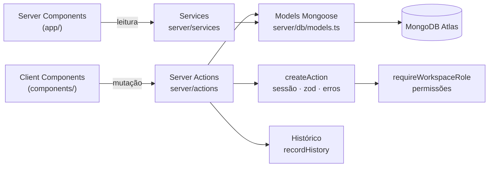

# Project Flow

Gestor de projetos para times pequenos: workspaces, quadro kanban, backlog com sprints, tarefas com
subtarefas e comentários, documentos em árvore e histórico de tudo o que mudou.

**Produção:** https://project-flow-core.vercel.app · clique em **Ver demonstração** para abrir um
workspace de exemplo sem cadastro (só leitura).

## Funcionalidades

- **Contas:** e-mail e senha, Google e GitHub (só e-mails verificados são vinculados a uma conta existente),
  confirmação de e-mail, recuperação de senha por link de uso único e página "Minha conta" (nome, senha,
  contas conectadas, exclusão da conta).
- **Segurança:** limite de tentativas no login, cadastro e recuperação de senha; cabeçalhos HTTP de
  segurança (CSP, HSTS, `frame-ancestors`); permissões por papel numa matriz única (`lib/permissions.ts`).
- **Workspaces** com papéis Dono, Admin e Membro; convites por e-mail (com ou sem conta), promover,
  remover e transferir a posse.
- **Projetos** com chave própria (PF, WEB…); o código das tarefas é sequencial por projeto (PF-12).
- **Arrastar e soltar** no quadro, com a ordem salva por coluna (índice fracionário) e alternativa
  pelo teclado no menu "Mover para…" de cada card.
- **Filtros** por texto, responsável, prioridade e tipo, guardados na URL (dá para mandar o link).
- **Busca global e paleta de comandos** (Ctrl K ou /): tarefas, projetos, documentos e atalhos.
- **Minhas tarefas:** tudo que está com você em todos os workspaces, agrupado por prazo.
- **Tema claro e escuro** (ou o do sistema).
- **Notificações:** sino com contador e caixa de entrada para atribuições, menções (@Nome) e
  comentários nas tarefas que você criou, recebeu ou comentou; e-mail opcional para atribuição e menção.
- **Comentários** editáveis, com @menções destacadas.
- **Outras visões do projeto:** lista ordenável por qualquer coluna, calendário por prazo (agenda no
  celular) e relatórios com tarefas por status, velocidade das sprints, progresso da sprint ativa,
  carga por responsável e por prioridade.
- **Documentos em Markdown** com abas Escrever e Visualizar (tabelas, checklists, código).
- **Primeiros passos** na visão geral do workspace, até o time estar configurado.
- **Instalável (PWA)** no celular e no computador.
- **Verificação em duas etapas** (TOTP, compatível com Google Authenticator, Authy e 1Password),
  com códigos de recuperação; segredo criptografado no banco e cada código vale uma vez.
- **Sessões:** trocar ou redefinir a senha e ligar o 2FA encerram todas as sessões abertas; "Sair de
  todos os dispositivos" em Minha conta.
- **IA na tarefa** (opcional, com `ANTHROPIC_API_KEY`): resumo da tarefa e sugestão de subtarefas
  com o Claude Haiku 5.5, limitado a 50 usos por workspace por dia.
- **API pública v1** só leitura, com tokens por workspace e especificação OpenAPI em
  `/api/v1/openapi.json` ([ADR 010](docs/adrs/010-api-publica-v1.md)).
- **Página inicial pública**, termos de uso, política de privacidade (LGPD), imagem de compartilhamento,
  sitemap e `/api/health` para monitores de disponibilidade.
- **Quadro kanban** com colunas configuráveis (nome, ordem e categoria A fazer / Em andamento /
  Concluído), criação rápida em cada coluna e "Mover para…".
- **Tarefa completa** num painel lateral (ou página própria pelo link): status, prioridade, tipo,
  responsável, sprint, story points, prazo, descrição, subtarefas, comentários e histórico.
- **Backlog e sprints:** planejar, iniciar e concluir sprints, decidindo para onde vão as tarefas abertas.
- **Documentos** em árvore, gerais do workspace ou por projeto, com editor Markdown e aviso quando
  outra pessoa salvou no meio (ninguém sobrescreve o outro sem saber).
- **Histórico** do workspace e atividade recente, em português.

## Stack

| Camada       | Escolha                                                                        |
| ------------ | ------------------------------------------------------------------------------ |
| Framework    | Next.js 16 (App Router, Cache Components, Server Actions) e React 19           |
| Interface    | shadcn/ui (Radix) + Tailwind CSS v4, com os tokens do Design System do projeto |
| Autenticação | NextAuth (credenciais, Google, GitHub) com adapter MongoDB                     |
| Dados        | MongoDB Atlas + Mongoose 9                                                     |
| Validação    | zod (mesmos schemas no cliente e no servidor)                                  |
| E-mail       | Resend (API HTTP), com fallback para o terminal em desenvolvimento             |
| Testes       | Vitest + MongoDB em memória (replica set)                                      |
| Hospedagem   | Vercel (funções em São Paulo, `gru1`), ao lado do cluster Atlas em `sa-east-1` |

## Arquitetura



- **Leituras:** Server Components chamam os services, sempre atrás de `<Suspense>` (a sessão é dado da requisição).
- **Mutações:** Server Actions criadas com `createAction` (ver [ADR 006](docs/adrs/006-uso-de-server-actions.md)).
- **Toda mutação relevante** grava uma entrada no histórico do workspace.
- **Exclusões em cascata** (workspace, projeto, documento com subdocumentos) rodam em transação.

```
app/                 rotas (auth, workspaces, w/[workspaceSlug]/…)
components/          componentes de tela; components/ui são os do shadcn
lib/                 sessão, rótulos em pt-BR, formatação, helpers puros
server/actions/      Server Actions (mutações)
server/services/     leituras e regras compartilhadas
server/lib/          createAction e checagem de papéis
server/db/           models Mongoose e DTOs
test/                setup do Vitest e helpers
docs/                ADRs, deploy, modelo ER e roadmap
```

## Rodando localmente

Pré-requisitos: Node 24 e acesso a um MongoDB (o cluster gratuito do Atlas serve).

```bash
npm install
cp .env.example .env.local   # preencha MONGODB_URI, NEXTAUTH_SECRET e SEED_PASSWORD
npm run seed                 # cria o workspace de demonstração no banco project-flow-dev
npm run dev
```

Entre em http://localhost:3000 com `demo@demo.projectflow.dev` e a senha de `SEED_PASSWORD`.
O seed recusa rodar no banco de produção (`project-flow`).

### Ambientes

| Ambiente         | Banco (`MONGODB_DB`)   |
| ---------------- | ---------------------- |
| Produção         | `project-flow`         |
| Preview (Vercel) | `project-flow-preview` |
| Desenvolvimento  | `project-flow-dev`     |

## Scripts

| Comando                    | O que faz                                                         |
| -------------------------- | ----------------------------------------------------------------- |
| `npm run dev`              | servidor de desenvolvimento                                       |
| `npm test`                 | testes (Vitest + MongoDB em memória)                              |
| `npm run test:e2e`         | ponta a ponta no navegador (Playwright + axe), depois do build    |
| `npm run typecheck`        | gera os tipos das rotas e roda o TypeScript                       |
| `npm run lint`             | ESLint                                                            |
| `npm run format`           | Prettier                                                          |
| `npm run seed`             | dados de demonstração no banco de desenvolvimento                 |
| `npm run migrate:comments` | move os comentários antigos para a coleção própria (M5)           |
| `npm run migrate:ranks`    | dá posição na coluna às tarefas antigas (M4)                      |
| `npm run migrate:statuses` | migra status antigos (texto) para entidade; aceita `-- --dry-run` |
| `npm run build`            | build de produção                                                 |

Os commits seguem Conventional Commits (`feat(frontend): …`), conferidos pelo commitlint. O pre-commit
roda ESLint e Prettier nos arquivos alterados. A CI do GitHub Actions roda tipos, lint, formatação,
testes e build em todo push e pull request.

## Documentação

- [Deploy no MongoDB Atlas e na Vercel](docs/deploy.md)
- [Roadmap de evolução](docs/roadmap.md)
- [Decisões de arquitetura (ADRs)](docs/adrs)
- [Modelo entidade-relacionamento](docs/modelos-er/modelo-er.pdf)
