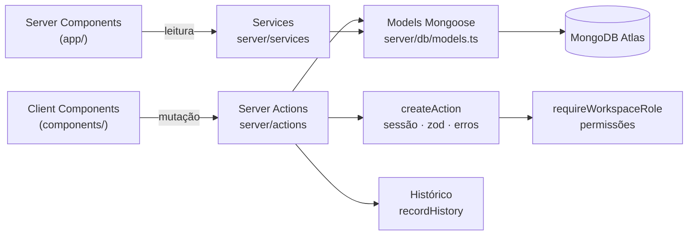

# Project Flow

[](https://github.com/Frantsys/project-flow-core/actions/workflows/ci.yml)
[](https://project-flow-core.vercel.app)


Gestor de projetos para times pequenos: workspaces, quadro kanban personalizável, backlog com sprints,
tarefas com subtarefas e comentários, documentos em árvore, relatórios e histórico de tudo o que mudou.

|                      |                                                                                                 |
| -------------------- | ----------------------------------------------------------------------------------------------- |
| **Aplicação no ar**  | https://project-flow-core.vercel.app                                                            |
| **Demonstração**     | na página inicial, **Ver demonstração** abre um workspace de exemplo, sem cadastro (só leitura) |
| **Saúde do serviço** | https://project-flow-core.vercel.app/api/health                                                 |
| **API pública (v1)** | https://project-flow-core.vercel.app/api/v1/openapi.json                                        |
| **Disciplina**       | Web II, avaliação da terceira unidade (tema livre)                                              |

## Critérios da avaliação (Web II, 3ª unidade)

Onde cada critério das diretrizes está no código:

| Critério                     | Como o projeto atende                                                                                                                                                | Onde ver                                             |
| ---------------------------- | -------------------------------------------------------------------------------------------------------------------------------------------------------------------- | ---------------------------------------------------- |
| Persistência e Singleton     | Uma conexão do Mongoose por instância, guardada no `global` (sem estourar conexões no serverless nem no hot reload)                                                  | `lib/db.ts`                                          |
| CRUD funcional               | Criar, ler, editar e excluir workspaces, projetos, colunas, tarefas, sprints, comentários, documentos e visões salvas                                                | `server/actions/*`, `server/services/*`              |
| Assíncrono e cache           | Server Components com Cache Components, `cache()` por requisição e `revalidatePath` depois de cada mutação                                                           | `lib/session.ts`, `server/actions/*`                 |
| NextAuth com JWT             | Login por e-mail e senha, Google e GitHub; sessão JWT com revogação; sair e "sair de todos os dispositivos"                                                          | `lib/auth.ts`, `components/user-menu.tsx`            |
| Proteção de rotas em camadas | Frontend: `proxy.ts` manda para o login. Backend: `requireUser` nas páginas e `requirePermission` em toda Server Action                                              | `proxy.ts`, `lib/session.ts`, `server/lib/access.ts` |
| Senhas com hash              | bcrypt (`bcryptjs`) no cadastro, na troca e na redefinição de senha                                                                                                  | `server/actions/auth.actions.ts`                     |
| App Router                   | Layouts aninhados (app → workspace → projeto), rotas dinâmicas `[workspaceSlug]`, `[projectKey]`, `[code]`, rota interceptada para abrir a tarefa por cima do quadro | `app/`                                               |
| Clean Architecture e tipagem | `components`, `lib`, `store`, `server/actions`, `server/services`, `server/db/models.ts` (models), `types.ts` e DTOs tipados                                         | ver "Arquitetura"                                    |
| Estado de UI com Zustand     | Painel aberto (paleta, atalhos, Minhas tarefas) e colunas recolhidas do quadro, com persistência no navegador                                                        | `store/ui-store.ts`                                  |
| `loading.tsx` e `error.tsx`  | Nas rotas do workspace, do projeto, de documentos e da conta; o erro oferece "Tentar de novo" (busca os dados de novo)                                               | `app/**/loading.tsx`, `app/**/error.tsx`             |
| Componentes com Tailwind     | shadcn/ui (copy-paste) sobre Radix + Tailwind CSS v4                                                                                                                 | `components/ui/`                                     |
| Responsividade e feedback    | Celular (filtros recolhidos, quadro rolável, painel em tela cheia), avisos, esqueletos e transições entre telas                                                      | `app/globals.css` ("Movimento")                      |
| Recursos nativos do Next     | `<Link>` com prefetch em toda a navegação e `next/image` nos avatares (Google e GitHub pelo otimizador)                                                              | `components/user-avatar.tsx`                         |
| Server × Client Components   | Páginas e layouts são Server Components; `"use client"` só nas folhas interativas (quadro, formulários, menus)                                                       | `app/`, `components/`                                |
| Deploy na Vercel             | Produção em https://project-flow-core.vercel.app; `MONGODB_URI`, `NEXTAUTH_SECRET` e as demais só nas variáveis da Vercel                                            | [docs/deploy.md](docs/deploy.md)                     |
| README e demonstração        | Este arquivo, o roteiro de testes ponta a ponta e a demonstração pública                                                                                             | `e2e/app.spec.ts`                                    |

## Funcionalidades

**Trabalho do dia a dia**

- **Quadro kanban** com arrastar e soltar (a ordem fica salva por coluna) e "Mover para…" pelo teclado.
- **Colunas personalizáveis** direto no quadro: criar, renomear, mudar a cor e o tipo (a fazer, em
  andamento, concluído), definir limite de tarefas (WIP), mover, recolher e excluir escolhendo para onde
  vão as tarefas.
- **Agrupar o quadro** em faixas por responsável, prioridade, tipo ou etiqueta; soltar um card em outra
  faixa troca o campo.
- **Filtros** por texto, responsável, prioridade, tipo e etiqueta, guardados na URL, e **visões salvas**
  (conjuntos de filtros com nome, por pessoa).
- **Etiquetas** com cor nas tarefas, nos cards e na lista.
- **Tarefa completa** num painel lateral ou em página própria: status, prioridade, tipo, responsável,
  sprint, story points, prazo (calendário em português), etiquetas, descrição, subtarefas, comentários
  com @menções e histórico.
- **Backlog e sprints:** planejar, editar, iniciar e concluir, decidindo para onde vão as tarefas abertas.
- **Outras visões:** lista ordenável, calendário por prazo e relatórios (status, velocidade, progresso da
  sprint, carga por pessoa e por prioridade).
- **Minhas tarefas** num painel flutuante (barra lateral ou `G M`), agrupadas pelo prazo.
- **Notificações** num painel no sino (Todas, Menções, Atribuídas), com e-mail opcional.
- **Lixeira:** tarefas e documentos excluídos ficam 30 dias, com "Desfazer" no aviso.
- **Busca global e paleta de comandos** (`Ctrl K` ou `/`) e **atalhos de teclado** (`C`, `G` + letra, `?`).
- **Documentos em Markdown** em árvore, gerais ou por projeto, com aviso quando outra pessoa salvou antes.

**Time e conta**

- **Workspaces** com papéis Dono, Admin e Membro; convites por e-mail, promover, remover e transferir a posse.
- **Contas:** e-mail e senha, Google e GitHub; confirmação de e-mail, recuperação de senha, verificação
  em duas etapas (TOTP) e página "Minha conta" com índice das seções.
- **Segurança:** limite de tentativas, cabeçalhos HTTP (CSP, HSTS), matriz única de permissões
  (`lib/permissions.ts`) e sessões encerradas ao trocar a senha.

**Extras**

- **IA** (opcional, Claude ou Gemini): resumo da tarefa, sugestão de subtarefas e um assistente na tela
  que conhece a página aberta. Só lê; tem limite diário.
- **API pública v1** só leitura, com tokens por workspace ([ADR 010](docs/adrs/010-api-publica-v1.md)).
- **Tema claro e escuro**, **PWA** instalável, página inicial pública, termos de uso e política de
  privacidade (LGPD).
- **Movimento:** transições entre telas com View Transitions; o cabeçalho do projeto fica parado e o
  conteúdo desliza para o lado da aba escolhida. Desligado com "reduzir movimento" no sistema.

## Stack

| Camada       | Escolha                                                                        |
| ------------ | ------------------------------------------------------------------------------ |
| Framework    | Next.js 16 (App Router, Cache Components, Server Actions) e React 19           |
| Interface    | shadcn/ui (Radix) + Tailwind CSS v4, com os tokens do Design System do projeto |
| Autenticação | NextAuth (credenciais, Google, GitHub) com adapter MongoDB                     |
| Dados        | MongoDB Atlas + Mongoose 9                                                     |
| Validação    | zod (mesmos schemas no cliente e no servidor)                                  |
| Estado de UI | Zustand (`store/`): painel aberto, colunas recolhidas; dados ficam no servidor |
| E-mail       | Resend (API HTTP), com fallback para o terminal em desenvolvimento             |
| Movimento    | View Transitions do React 19.3 (troca de tela e de aba)                        |
| Testes       | Vitest + MongoDB em memória (replica set) e Playwright + axe (ponta a ponta)   |
| Hospedagem   | Vercel (funções em São Paulo, `gru1`), ao lado do cluster Atlas em `sa-east-1` |

## Arquitetura



- **Leituras:** Server Components chamam os services, sempre atrás de `<Suspense>` (a sessão é dado da requisição).
- **Mutações:** Server Actions criadas com `createAction` (ver [ADR 006](docs/adrs/006-uso-de-server-actions.md)).
- **Toda mutação relevante** grava uma entrada no histórico do workspace.
- **Carregamento e erro:** `loading.tsx` e `error.tsx` nas rotas do workspace, do projeto e das telas
  da conta, além dos esqueletos em `<Suspense>` dentro das páginas.
- **Exclusões em cascata** (workspace, projeto, documento com subdocumentos) rodam em transação.

```
app/                 rotas (auth, workspaces, w/[workspaceSlug]/…)
components/          componentes de tela; components/ui são os do shadcn
lib/                 sessão, rótulos em pt-BR, formatação, helpers puros
store/               estado só do cliente (Zustand)
server/actions/      Server Actions (mutações)
server/services/     leituras e regras compartilhadas
server/lib/          createAction e checagem de papéis
server/db/           models Mongoose e DTOs
test/                setup do Vitest e helpers
docs/                ADRs, deploy, modelo ER e roadmap
```

## Rodando localmente

Pré-requisitos: Node 24 e acesso a um MongoDB (o cluster gratuito do Atlas serve).

```bash
npm install
cp .env.example .env.local   # preencha MONGODB_URI, NEXTAUTH_SECRET e SEED_PASSWORD
npm run seed                 # cria o workspace de demonstração no banco project-flow-dev
npm run dev
```

Entre em http://localhost:3000 com `demo@demo.projectflow.dev` e a senha de `SEED_PASSWORD`.
O seed recusa rodar no banco de produção (`project-flow`).

### Variáveis de ambiente

Todas estão em [`.env.example`](.env.example). Em produção ficam só nas variáveis da Vercel (nunca no
repositório).

| Variável                                    | Obrigatória | Para quê                                                |
| ------------------------------------------- | ----------- | ------------------------------------------------------- |
| `MONGODB_URI`                               | sim         | conexão com o MongoDB Atlas                             |
| `NEXTAUTH_SECRET`                           | sim         | assina os tokens JWT da sessão                          |
| `NEXTAUTH_URL`                              | sim         | endereço do app (links dos e-mails, callbacks do OAuth) |
| `MONGODB_DB`                                | não         | banco do ambiente (padrão `project-flow`)               |
| `GOOGLE_CLIENT_ID` / `GOOGLE_CLIENT_SECRET` | não         | entrar com Google                                       |
| `GITHUB_ID` / `GITHUB_SECRET`               | não         | entrar com GitHub                                       |
| `RESEND_API_KEY` / `EMAIL_FROM`             | produção    | e-mails de confirmação, senha e notificações            |
| `ANTHROPIC_API_KEY` ou `GEMINI_API_KEY`     | não         | recursos de IA (sem chave, não aparecem)                |
| `DEMO_USER_EMAIL`                           | não         | conta da demonstração pública                           |
| `SEED_PASSWORD`                             | dev         | senha da conta criada pelo `npm run seed`               |

### Ambientes

| Ambiente         | Banco (`MONGODB_DB`)   |
| ---------------- | ---------------------- |
| Produção         | `project-flow`         |
| Preview (Vercel) | `project-flow-preview` |
| Desenvolvimento  | `project-flow-dev`     |

## Scripts

| Comando                    | O que faz                                                         |
| -------------------------- | ----------------------------------------------------------------- |
| `npm run dev`              | servidor de desenvolvimento                                       |
| `npm test`                 | testes (Vitest + MongoDB em memória)                              |
| `npm run test:e2e`         | ponta a ponta no navegador (Playwright + axe), depois do build    |
| `npm run typecheck`        | gera os tipos das rotas e roda o TypeScript                       |
| `npm run lint`             | ESLint                                                            |
| `npm run format`           | Prettier                                                          |
| `npm run seed`             | dados de demonstração no banco de desenvolvimento                 |
| `npm run migrate:comments` | move os comentários antigos para a coleção própria (M5)           |
| `npm run migrate:ranks`    | dá posição na coluna às tarefas antigas (M4)                      |
| `npm run migrate:statuses` | migra status antigos (texto) para entidade; aceita `-- --dry-run` |
| `npm run build`            | build de produção                                                 |

Os commits seguem Conventional Commits (`feat(frontend): …`), conferidos pelo commitlint. O pre-commit
roda ESLint e Prettier nos arquivos alterados. A CI do GitHub Actions roda tipos, lint, formatação,
testes e build em todo push e pull request.

## Documentação

- [Deploy no MongoDB Atlas e na Vercel](docs/deploy.md)
- [Roadmap de evolução](docs/roadmap.md)
- [Decisões de arquitetura (ADRs)](docs/adrs)
- [Modelo entidade-relacionamento](docs/modelos-er/modelo-er.pdf)
