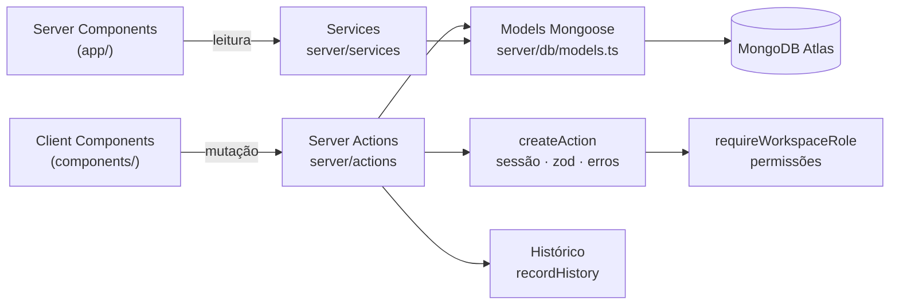

# Project Flow

Gestor de projetos para times pequenos: workspaces, quadro kanban, backlog com sprints, tarefas com
subtarefas e comentários, documentos em árvore e histórico de tudo o que mudou.

**Produção:** https://project-flow-core.vercel.app

## Funcionalidades

- **Contas:** e-mail e senha, Google e GitHub (só e-mails verificados são vinculados a uma conta existente).
- **Workspaces** com papéis Dono, Admin e Membro; adicionar, promover e remover pessoas.
- **Projetos** com chave própria (PF, WEB…); o código das tarefas é sequencial por projeto (PF-12).
- **Quadro kanban** por status, com criação rápida em cada coluna e "Mover para…".
- **Tarefa completa** num painel lateral (ou página própria pelo link): status, prioridade, tipo,
  responsável, sprint, story points, prazo, descrição, subtarefas, comentários e histórico.
- **Backlog e sprints:** planejar, iniciar e concluir sprints, decidindo para onde vão as tarefas abertas.
- **Documentos** em árvore, gerais do workspace ou por projeto, com editor Markdown.
- **Histórico** do workspace e atividade recente, em português.

## Stack

| Camada       | Escolha                                                                        |
| ------------ | ------------------------------------------------------------------------------ |
| Framework    | Next.js 16 (App Router, Cache Components, Server Actions) e React 19           |
| Interface    | shadcn/ui (Radix) + Tailwind CSS v4, com os tokens do Design System do projeto |
| Autenticação | NextAuth (credenciais, Google, GitHub) com adapter MongoDB                     |
| Dados        | MongoDB Atlas + Mongoose 9                                                     |
| Validação    | zod (mesmos schemas no cliente e no servidor)                                  |
| Testes       | Vitest + MongoDB em memória (replica set)                                      |
| Hospedagem   | Vercel (funções em São Paulo, `gru1`), ao lado do cluster Atlas em `sa-east-1` |

## Arquitetura



- **Leituras:** Server Components chamam os services, sempre atrás de `<Suspense>` (a sessão é dado da requisição).
- **Mutações:** Server Actions criadas com `createAction` (ver [ADR 006](docs/adrs/006-uso-de-server-actions.md)).
- **Toda mutação relevante** grava uma entrada no histórico do workspace.
- **Exclusões em cascata** (workspace, projeto, documento com subdocumentos) rodam em transação.

```
app/                 rotas (auth, workspaces, w/[workspaceSlug]/…)
components/          componentes de tela; components/ui são os do shadcn
lib/                 sessão, rótulos em pt-BR, formatação, helpers puros
server/actions/      Server Actions (mutações)
server/services/     leituras e regras compartilhadas
server/lib/          createAction e checagem de papéis
server/db/           models Mongoose e DTOs
test/                setup do Vitest e helpers
docs/                ADRs, deploy, modelo ER e roadmap
```

## Rodando localmente

Pré-requisitos: Node 24 e acesso a um MongoDB (o cluster gratuito do Atlas serve).

```bash
npm install
cp .env.example .env.local   # preencha MONGODB_URI, NEXTAUTH_SECRET e SEED_PASSWORD
npm run seed                 # cria o workspace de demonstração no banco project-flow-dev
npm run dev
```

Entre em http://localhost:3000 com `demo@demo.projectflow.dev` e a senha de `SEED_PASSWORD`.
O seed recusa rodar no banco de produção (`project-flow`).

### Ambientes

| Ambiente         | Banco (`MONGODB_DB`)   |
| ---------------- | ---------------------- |
| Produção         | `project-flow`         |
| Preview (Vercel) | `project-flow-preview` |
| Desenvolvimento  | `project-flow-dev`     |

## Scripts

| Comando             | O que faz                                         |
| ------------------- | ------------------------------------------------- |
| `npm run dev`       | servidor de desenvolvimento                       |
| `npm test`          | testes (Vitest + MongoDB em memória)              |
| `npm run typecheck` | gera os tipos das rotas e roda o TypeScript       |
| `npm run lint`      | ESLint                                            |
| `npm run format`    | Prettier                                          |
| `npm run seed`      | dados de demonstração no banco de desenvolvimento |
| `npm run build`     | build de produção                                 |

Os commits seguem Conventional Commits (`feat(frontend): …`), conferidos pelo commitlint. O pre-commit
roda ESLint e Prettier nos arquivos alterados. A CI do GitHub Actions roda tipos, lint, formatação,
testes e build em todo push e pull request.

## Documentação

- [Deploy no MongoDB Atlas e na Vercel](docs/deploy.md)
- [Roadmap de evolução](docs/roadmap.md)
- [Decisões de arquitetura (ADRs)](docs/adrs)
- [Modelo entidade-relacionamento](docs/modelos-er/modelo-er.pdf)
